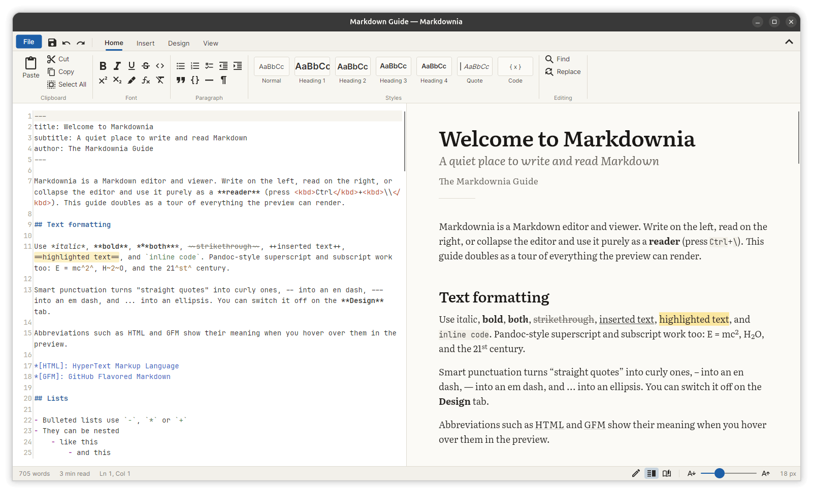

# Markdownia



A Markdown editor and viewer built with .NET 10 and Avalonia 12 and compiled to a single native executable with Native AOT. The editor is on the left and the preview on the right. Collapse the editor to use Markdownia as a pure reader.

The preview is drawn entirely with Avalonia controls. There is no embedded web view. Its main goal is clear, comfortable typography: bundled reading fonts, a limited line length, pixel-snapped line heights, and a choice of text rendering modes.

## Features

- **Dual pane with a collapsible editor.** Choose Editor, Split or Reader layout from the View tab or the status bar, or press `Ctrl+\`. The splitter position is remembered. With Sync Scrolling on, whichever pane you are scrolling leads and the other follows.
- **A Word-style ribbon** with a File menu, a quick-access toolbar, and Home / Insert / Design / View tabs:
  - **Home:** clipboard; inline formatting (bold, italic, underline/insert, strikethrough, code, superscript, subscript, highlight, inline math, clear formatting); lists, indentation, quotes; a **Styles gallery** (Normal, Heading 1–4, Quote, Code); find and replace.
  - **Insert:** links, pictures, a hover-grid **table picker**, code blocks with a language menu, equations, footnotes, abbreviations, definition lists, links to headings, GitHub alerts and Pandoc fenced divs, horizontal lines, date, and symbols.
  - **Design:** a **theme gallery**, reading font, text size, line spacing, text width, code font, justification, smart punctuation, and text rendering mode.
  - **View:** layout, editor word wrap, line numbers, scroll sync, editor font and size, and a document outline.
- **GitHub Flavored Markdown:** tables, task lists, strikethrough, autolinks, alerts (`> [!NOTE]`), and heading anchors.
- **Pandoc extensions:** footnotes, `^superscript^`, `~subscript~`, abbreviations (`*[HTML]: …`), definition lists, fenced divs (`::: warning`), grid tables, fancy list markers (`a.`, `iv.`), `{#id .class}` attributes, YAML and `%` title blocks, and implicit figures (an image alone in a paragraph gets a caption).
- **Images:** PNG, JPEG, GIF, WebP and BMP, from local paths, URLs or data URIs, inline or as captioned figures. Pandoc size attributes (`{width=480}`, `{width=50%}`, `{height=2in}`) and HTML `width`/`height` attributes are honored, and wide images are scaled to fit the text column. Drag the handle in an image's corner in the preview to resize it; the new width is written back to the Markdown. Double-click the handle to reset the size.
- **Math:** `$inline$` and `$$display$$` (and ` ```math ` blocks) are typeset natively with CSharpMath and Latin Modern Math. Inline formulas sit on the text baseline.
- **Code highlighting** for C#, C++, C, Python, JavaScript, TypeScript, Java, Kotlin, Rust, Go, Swift, F#, PHP, Ruby, SQL, shell, PowerShell, JSON, YAML, TOML, HTML/XML, CSS, Diff, Dockerfile and Lua. It uses a small reflection-free tokenizer, so it is AOT-safe. Each code block has a copy button.
- **Nine themes:** Paper, GitHub Light, Sepia and Solarized Light; GitHub Dark, Nord, One Dark, Solarized Dark and Dracula. Each theme colors the chrome, the editor, the preview and the code.
- **Typography:** bundled Literata, Source Serif 4, Atkinson Hyperlegible, Inter and JetBrains Mono, with any installed font also available. Settings cover size (12–32 px, also `Ctrl+[` / `Ctrl+]` / Ctrl+wheel), line spacing, measure (narrow / medium / wide / full), Smooth / Sharp / Subpixel rendering, curly quotes and dashes, tabular numbers in lists, and code ligatures turned off for clarity.
- **The editor** (AvaloniaEdit) has theme-aware Markdown highlighting, list continuation on Enter, Tab / Shift+Tab to indent list items, and an editor font and size of your choice.
- **Files:** open, save, recent files, drag and drop (Markdown files open; images are inserted as links), unsaved-changes prompts, and export to standalone HTML styled like the current theme.

## Building

You need the [.NET 10 SDK](https://dotnet.microsoft.com/download).

```bash
dotnet run --project src/Markdownia            # run (JIT, for development)
dotnet run --project src/Markdownia -- README.md   # open a file
dotnet test                                    # unit + headless UI tests
```

### Native AOT

Native AOT compiles for the operating system you build on, so publish on each target OS:

```bash
dotnet publish src/Markdownia -c Release -r linux-x64   -o artifacts/linux-x64
dotnet publish src/Markdownia -c Release -r win-x64     -o artifacts/win-x64
dotnet publish src/Markdownia -c Release -r osx-arm64   -o artifacts/osx-arm64
```

Native toolchain prerequisites:

- **Linux:** `clang` (or `gcc`; the project falls back to gcc automatically when clang is missing) and `zlib1g-dev`.
- **Windows:** Visual Studio 2022+ with the "Desktop development with C++" workload.
- **macOS:** Xcode command line tools.

The output is a single `Markdownia` executable (about 36 MB including fonts) plus Skia and HarfBuzz native libraries (`libSkiaSharp`, `libHarfBuzzSharp`), which must stay next to it. The `.dbg` file holds debug symbols and doesn't need to be shipped.

To check an AOT build without opening a window, run:

```bash
artifacts/linux-x64/Markdownia --smoke-test out.png [document.md]
```

It renders the main window and the full document preview offscreen to `out.png` and `out-preview.png`, then exits with status 0 if everything worked.

### Debian package

```bash
packaging/linux/build-deb.sh              # → artifacts/deb/markdownia_<version>_amd64.deb
sudo apt install ./artifacts/deb/markdownia_1.0.0_amd64.deb
```

The package installs the program in `/usr/lib/markdownia` with a `markdownia` command, a desktop entry, and icons. It registers Markdownia for Markdown files (`text/markdown`), so it appears in the application menu and under "Open With" for `.md` files. To make it the default app for Markdown files, choose **File › Open Markdown Files with Markdownia**. This menu item appears only in installed builds. The maintainer field comes from `git config user.name`/`user.email`; set `DEB_MAINTAINER="Name <email>"` to override it. The executable needs glibc 2.38 or newer (Ubuntu 24.04, Debian 13 or later). Pass `linux-arm64` to build for ARM, which requires an arm64 cross toolchain.

### Icon

The icon is drawn by `tools/IconGen`, which writes the SVG and PNG sizes for Linux (`packaging/linux/icons`), the window icon (`src/Markdownia/Assets/Icon`) and the Windows `.ico`. Change the design in `tools/IconGen/Program.cs` and run `dotnet run --project tools/IconGen`.

`tools/Snapshot` is a development helper that renders the real main window headlessly to PNG, with options for theme, tab, layout, scroll position and font. It is useful for checking visual changes.

## Keyboard shortcuts

| Action | Shortcut | Action | Shortcut |
| --- | --- | --- | --- |
| New / Open / Save | `Ctrl+N` / `Ctrl+O` / `Ctrl+S` | Save As | `Ctrl+Shift+S` |
| Bold / Italic | `Ctrl+B` / `Ctrl+I` | Underline (insert) | `Ctrl+U` |
| Inline code | `Ctrl+E` | Strikethrough | `Ctrl+Shift+X` |
| Superscript / Subscript | `Ctrl+Shift+=` / `Ctrl+=` | Highlight | `Ctrl+Shift+H` |
| Inline math / Equation | `Ctrl+M` / `Alt+=` | Link | `Ctrl+K` |
| Heading 1–6 / Normal | `Ctrl+1`…`Ctrl+6` / `Ctrl+0` | Footnote | `Ctrl+Alt+F` |
| Bullets / Numbers / Tasks | `Ctrl+Shift+8` / `7` / `9` | Quote | `Ctrl+Shift+Q` |
| Clear formatting | `Ctrl+Space` | Find / Replace | `Ctrl+F` / `Ctrl+H` |
| Reader ↔ Split | `Ctrl+\` | Editor only ↔ Split | `Ctrl+Shift+\` |
| Text size | `Ctrl+[` / `Ctrl+]` / Ctrl+wheel | Collapse ribbon | `Ctrl+F1` |

## Project layout

```
src/Markdownia/
  Controls/      Ribbon controls (buttons, toggle buttons, groups) and the preview pane
  Editing/       Markdown editing commands and editor syntax highlighting
  Rendering/     Markdig pipeline, Markdig AST → Avalonia renderer, code highlighter, math control, images
  Services/      Settings (source-generated JSON), fonts, HTML export, app icon, desktop integration, smoke test
  Theming/       Theme definitions and resource publishing
  Themes/        AXAML styles, control themes and icon geometry
  Views/         Main window and dialogs
  Assets/        Bundled fonts, the window icon and the built-in Markdown guide
tests/Markdownia.Tests/   xUnit v3 + Avalonia headless tests
tools/Snapshot/           Headless screenshot helper
tools/IconGen/            Application icon generator
packaging/linux/          Desktop entry, icons and the .deb build script
```

Everything is AOT- and trim-safe: compiled XAML bindings, source-generated JSON and regexes, editor highlighting built in code (no XSHD loading), and no reflection-based view location. `dotnet publish` produces no trim or AOT warnings.

## Known limitations

- SVG images are not rendered; their alt text is shown instead.
- Raw HTML blocks are reduced to their text and images. Common inline tags (`<kbd>`, `<sup>`, `<sub>`, `<mark>`, `<b>`, `<i>`, `<br>`, …) are supported.
- Pandoc features that Markdig does not implement are not available: inline notes `^[…]`, citations, line blocks and example lists.
- A footnote definition placed directly after a definition list is read as a paragraph (Markdig behavior). Putting any other block between them avoids it.
- Text can be selected within one paragraph, list item or code block at a time, not across several.

## Licenses

Bundled fonts are licensed under the SIL Open Font License 1.1, and the icons come from Material Design Icons (Apache 2.0). See [THIRD-PARTY-NOTICES.md](THIRD-PARTY-NOTICES.md).
